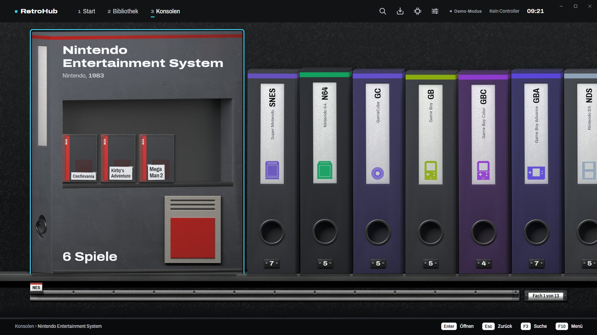
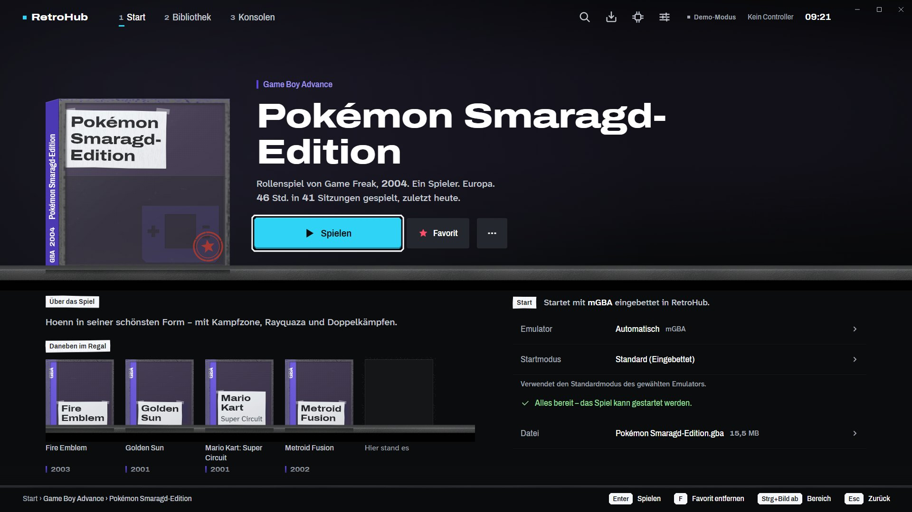
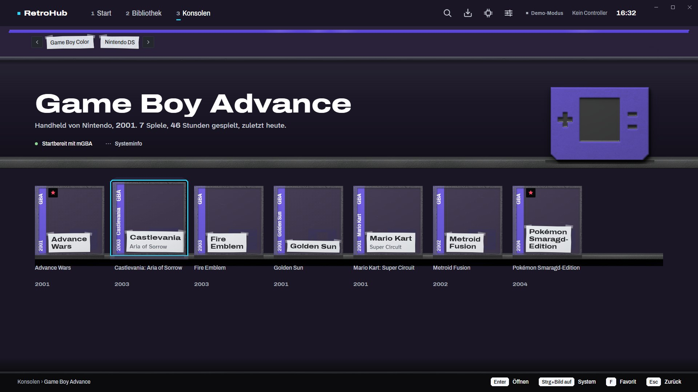
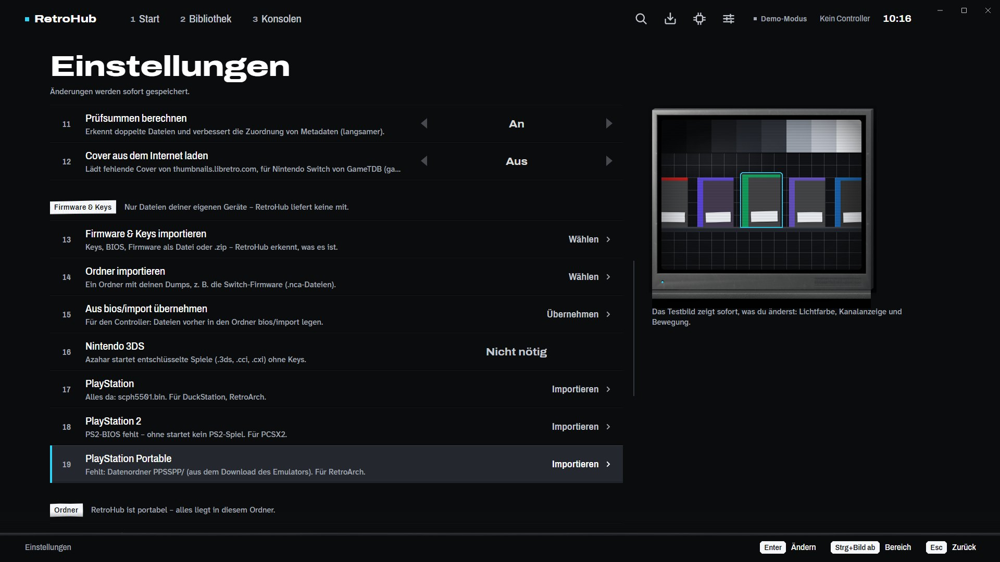

# RetroHub

**A portable retro-game launcher for Windows – your whole collection on one shelf, every console in one window.**

RetroHub brings your own games, the right emulators and your saves together in **one folder**. Pick a game,
press *Spielen*, and it starts – embedded in RetroHub's window or in full screen. Keyboard, mouse and
controller work everywhere. The interface is **German**, with English available.

> **Unofficial fan project.** RetroHub is not affiliated with Nintendo, Sony, Sega or any other console maker.
> All names are trademarks of their owners. **RetroHub ships no games (ROMs), no BIOS, no keys and no firmware** –
> use only dumps of games and consoles you own.

## What it does

- **One folder for everything:** games, saves, savestates, screenshots, BIOS, keys, firmware and the emulators'
  own data stay inside the RetroHub folder – nothing goes to `%APPDATA%` or `Documents`. Copy the folder to
  another disk and it keeps working.
- **Emulators included:** the installer brings mGBA, melonDS, DeSmuME, Azahar, Dolphin, Cemu and RetroArch
  (with the cores RetroHub uses) and can download the Switch emulator Eden during setup. Each one is set up
  portable and ready – no configuring.
- **32 systems** from Atari 2600 to Switch, recognised automatically from your folders, with covers and
  metadata.
- **Firmware & Keys importieren:** one place in *Einstellungen* per console. Point it at your own dumps
  (files, folders or .zip) – RetroHub recognises what each file is and puts it where the emulator expects it.
- **Play inside RetroHub:** many emulators run embedded in RetroHub's window; *Spiel beenden* returns you to
  where you were, play time is tracked.

| | |
|---|---|
|  |  |
|  | |

## Install

1. Download **RetroHub-Setup.exe** from the [latest release](../../releases/latest).
2. Run it. It installs per user into `%USERPROFILE%\RetroHub` – no admin rights needed.
   Windows SmartScreen may warn because the setup is not signed: *Weitere Informationen → Trotzdem ausführen*.
3. Start RetroHub, put your games into `games\<system>\` (or add an existing folder under *Importe › Ordner hinzufügen*), and
   import BIOS/keys/firmware where a console needs them.

Uninstalling removes only the program files – your games, saves, BIOS, keys and settings stay in the folder.

**Guide:** [Anleitung (Deutsch)](docs/ANLEITUNG.md) · [Guide (English)](docs/GUIDE.md) – what each console
needs, where everything lives, controller setup, troubleshooting.

## Requirements

Windows 10 (1903) or 11, 64-bit. About 1.4 GB disk space plus your games. Internet only for optional cover
downloads and the optional Eden download during setup.

## Building

.NET 10 SDK. `build\publish.ps1` publishes the app (self-contained) and the starter; `build\installer\build.ps1`
assembles the installer from pinned, hash-checked official emulator downloads (`build\installer\emulators.json`)
and compiles it with Inno Setup 6. The Konsolen artwork is rendered with Blender from the scripts in
`build\tools\assets`.

## Licences

RetroHub is free software under the **GNU GPL v3** ([LICENSE](LICENSE)). The bundled emulators keep their own
licences (GPL-2.0/3.0, MPL-2.0); their licence texts are installed next to each emulator and listed in
`LIESMICH.txt`. RetroHub is free and must not be sold or used commercially, because several bundled
RetroArch cores (Snes9x, Genesis Plus GX, PicoDrive) allow **non-commercial distribution only**. Donations to
support RetroHub are welcome and allowed. Arcade games use the bundled MAME core (MAME 0.282, GPL-2.0-or-later). Fonts: Archivo and Atkinson
Hyperlegible (SIL Open Font License).
